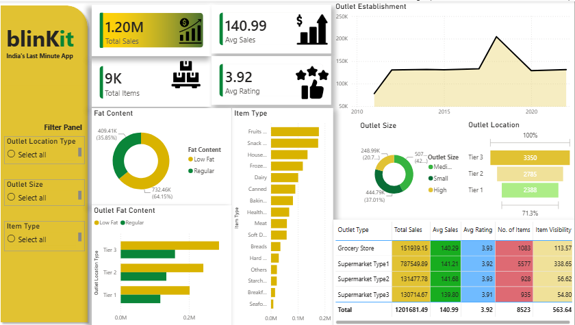

# Blinkit Dashboard | Power BI

An interactive **Blinkit Sales Analysis Dashboard** built using Microsoft Power BI to analyze sales performance, product categories, outlet characteristics, and customer ratings.

## Dashboard Preview



## Project Overview

This project focuses on analyzing Blinkit's grocery sales data to uncover meaningful business insights. The dashboard provides interactive visualizations and key performance indicators (KPIs) to help understand sales trends, product performance, and outlet-level operations.

## Project Objectives

- Analyze overall sales performance.
- Identify top-performing product categories.
- Compare sales across different outlet types and sizes.
- Understand the impact of fat content on sales.
- Analyze outlet establishment trends.
- Evaluate customer ratings and item distribution.

## Tools & Technologies

- **Power BI** — Interactive dashboard and data visualization
- **Power Query** — Data cleaning and transformation
- **DAX** — KPI calculations and measures
- **Microsoft Excel** — Dataset preparation

## Key Performance Indicators (KPIs)

| KPI | Description |
| --- | --- |
| Total Sales | Overall revenue generated |
| Average Sales | Average sales value per item or transaction, depending on the measure |
| Number of Items | Total items represented in the dataset |
| Average Rating | Average customer rating |

## Dashboard Features

- Sales analysis by item type
- Outlet performance comparison
- Sales analysis by outlet location tier
- Product analysis by fat content
- Outlet establishment trend analysis
- Customer rating analysis
- Interactive filters and slicers

## Project Structure

```
Blinkit-Dashboard/
│
├── README.md
├── Blinkit_Dashboard.pbix
├── BlinkIT Grocery Data.xlsx
└── dashboard.png
    
```

## Getting Started

### Prerequisites

- Microsoft Power BI Desktop
- The dataset used in this project

### Installation

1. Clone the repository:

```
   git clone https://github.com/mahathiru0203/Blinkit-Dashboard.git
```

2. Navigate to the project folder:

```
   cd Blinkit-Dashboard
```

3. Open `Blinkit_Dashboard.pbix` in Power BI Desktop.
4. Update the data source path if necessary.
5. Refresh the data and explore the interactive dashboard.

## Business Insights

The dashboard can help identify:

- Product categories contributing the most to sales.
- Differences in sales across outlet sizes and locations.
- Sales patterns across outlet establishment years.
- Product distribution based on fat content.
- Relationships between outlet performance and customer ratings.

## Future Improvements

- Integrate regularly refreshed sales data.
- Add time-based sales comparisons.
- Include forecasting and trend analysis.
- Publish an online interactive version of the dashboard.
